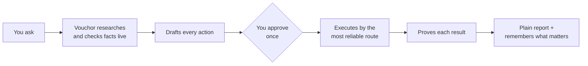

# Vouchor

**An AI assistant that does real work for you, and proves it.**

Vouchor is a self-hosted, open-source engine that turns a plain request like *"email these seven suppliers about the battery part and put the follow-up call on my calendar"* into real actions. Each action is checked before it's prepared, approved by you before it runs, and proven after it runs.

> **Status: pre-alpha, design stage.** The architecture, requirements and implementation plan are written. The code is not built yet. Anything below marked *planned* does not work today. Follow the [roadmap](#roadmap) to see progress.

---

## Why Vouchor?

Most AI agents fail in the same ways once they touch the real world:

- They **believe whatever a search result says**, even when it's out of date.
- They **ask permission at the wrong time**: for every click, or not at all.
- They **think "the button was clicked" means "the job is done."**
- When something times out, they **try again and send your email twice.**
- Their "memory" **fills up with junk** from past runs.

Vouchor is built around six promises that fix these failures.

## The six promises

| | Promise | What it means for you |
|---|---|---|
| 1 | **Most reliable route first** | Vouchor tries an official integration first (like the Gmail API), then a pre-built playbook, then a real browser, and finally prepares a file you can use yourself. If one route breaks, it moves to the next and tells you why. |
| 2 | **Facts are checked at the source** | A search result is only a hint about where to look. Before Vouchor uses an email address, price or stock level, it reads the live page or API and keeps the proof. |
| 3 | **Prepare everything first** | All the research and drafting for a batch is finished before you're asked anything. |
| 4 | **One approval, at the right moment** | Anything that acts in your name (sending, booking, posting) waits for you. You review the whole batch once, then approve, edit or reject each item. |
| 5 | **Done means proven, and never twice** | An action only counts as done after Vouchor checks independently that it happened, for example by finding the email in your Sent folder. Retries check first, so nothing is duplicated. |
| 6 | **Honest reports, clean memory** | You get a short, plain report based on the audit log. Vouchor remembers only lasting facts, like your preferences and verified contacts, not clutter. |

## How it works



## What you'll be able to do *(planned)*

- **Email:** send through Gmail or any mail server, and search or summarise your inbox.
- **Calendar:** schedule Google Calendar events with no accidental double-booking.
- **Notes:** add notes to Google Keep. If no API is available, Vouchor uses a real browser.
- **Batch outreach:** contact many vendors at once, with every contact detail verified.
- **Web forms:** fill and submit forms on websites, with confirmation checked afterwards.
- **Files:** when nothing else works, get a ready-to-use draft (`.eml`, `.ics`, `.csv`).

## Yours, on your machine

- **Self-hosted:** runs on your laptop with Docker, or on your own server or cloud.
- **No paid services required:** works with local AI models through Ollama, or any OpenAI-compatible endpoint you choose.
- **Portable to any cloud:** the same deployment works on a laptop cluster, a small VM or a large Kubernetes cluster, set up with open-source infrastructure-as-code (OpenTofu + Helm).
- **Open source:** licensed under AGPL-3.0. You're free to use, study, change and self-host it.

## Quickstart *(planned, available from Phase 0)*

```bash
git clone https://github.com/KshitijV97/vouchor.git && cd vouchor
make setup up
open http://localhost:8000/docs
```

## Roadmap

| Phase | What lands | Status |
|---|---|---|
| 0 | Foundation: tooling, tests, local stack, deployable skeleton | planned |
| 1 | Durable approvals: batches pause for you and survive restarts | planned |
| 2 | Exactly-once actions: verified email sending, no duplicates | planned |
| 3 | Live fact checking and browser automation | planned |
| 4 | Plain reports and long-term memory | planned |
| 5 | Gmail, Google Calendar and Google Keep use cases | planned |
| 6 | Production hardening: auth, observability, resilience | planned |
| 7 | One-command cloud deployment and first release (v0.1.0) | planned |

See the full [implementation plan](docs/project/implementation-plan.md).

## Documentation

| For | Read |
|---|---|
| Everyone | This page and the [documentation home](docs/index.md) |
| People using Vouchor | [Guide](docs/guide/index.md): setup and step-by-step use cases (Gmail, Calendar, Keep, …) |
| Engineers who want to know how it was built | [Build journal](docs/build/index.md) and [engineering reference](docs/project/README.md) |

## Contributing

Vouchor is built with the [CraftRail](https://github.com/KshitijV97/craft-rail) workflow: specifications before code, tests linked to requirements, and recorded evidence. See [CONTRIBUTING.md](CONTRIBUTING.md).

## License

Copyright (C) 2026 Kshitij and Vouchor contributors. Licensed under the [GNU Affero General Public License v3.0 or later](LICENSE). You can use, modify and self-host Vouchor freely. If you distribute a modified version, or run one as a service for other people, you must share your changes under the same license. See [NOTICE](NOTICE) for name and attribution terms.
