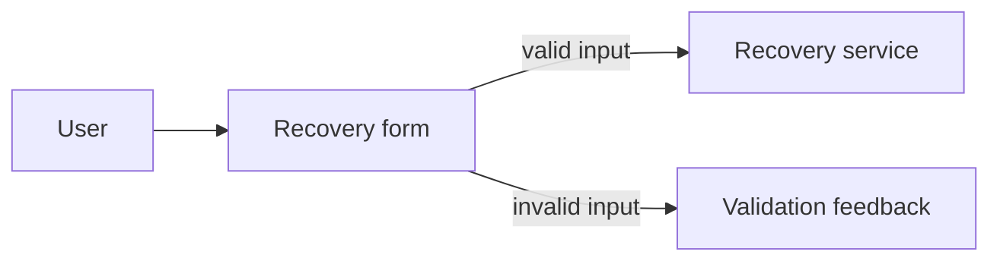
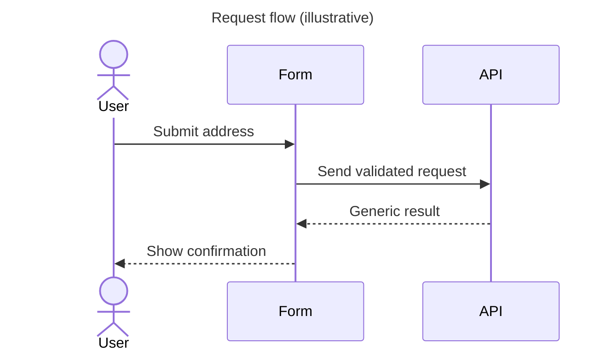

# Mermaid and diagram guide

Mermaid keeps common diagrams as editable text beside the explanation they support. It is suitable for many context, sequence, flow, and state views. It is not the right tool for every diagram: a complex network topology or heavily annotated business process may need another format. If another editor is used, commit its editable source and link to it.

## Place source near its explanation

Use a fenced `mermaid` block in a Markdown document when the diagram is tightly coupled to that page. Use a `.mmd` file under `specs/<feature>/diagrams/` when a feature has multiple diagrams or the sequence needs a separately reviewable file. Avoid keeping a rendered image as the only source. A build artifact or screenshot can supplement source but should not replace it.

## Select a diagram that answers one question

| Diagram | Question answered | Typical participants |
|---|---|---|
| Flowchart | What is the order of steps or decision paths? | Activities, branches, inputs/outputs |
| Sequence | Who sends what, and in what order? | Actors, UI/API/services, messages, failures |
| State diagram | What states can an entity occupy, and which events move it? | States, transitions, guards, terminal state |
| C4 context/container/component | Where is a boundary and what depends on what? | People, external systems, runtimes, modules |
| ER/data-flow | What information is related or how does it move? | Entities, stores, transformations, trust boundaries |

Do not force every behavior into a flowchart. A state machine is clearer when validity depends on current state; a sequence is clearer when ordering and messages matter.

## Naming and metadata

Add a title and the scope/abstraction/last-reviewed metadata in the surrounding document. Give participants and nodes stable, descriptive names. Use the same name in related diagrams. Label relationships with meaningful verbs, and distinguish data stores from processes. For flows that carry sensitive data, label the data category or mark the trust boundary without drawing actual secrets or personal information.

Mermaid source should remain readable in a Git diff. Break long flows into subgraphs or link to a focused secondary view instead of packing every component onto one page. Keep labels short; explain constraints and exceptions in prose.

## Example: flow and sequence answer different questions

The flow shows decision paths but not interaction order. A sequence can show the request order:

These examples omit production security details. A real design should show relevant rejection, rate-limit, outage, and abuse paths.

## Preview and validation

Mermaid is source; a renderer is a preview. GitHub renders many Mermaid diagram types in Markdown. The CraftRail website uses Zensical's documented Mermaid integration to render supported diagram fences. The local Python validator checks that a declaration is present, not that Mermaid syntax is semantically valid or that the rendered output is readable. Use the site preview and review diagrams at the actual viewport where readers will use them.

Zensical currently documents official support for flowcharts, sequences, state diagrams, class diagrams, and entity-relationship diagrams; other Mermaid types may render but are not a documented supported set. Keep examples to supported diagram types unless there is a clear reason. See [architecture documentation](architecture-documentation-guide.md) for choosing views.
