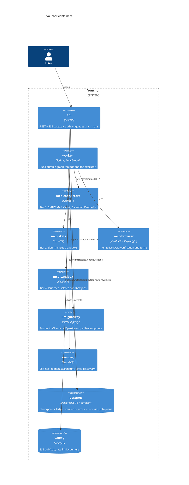

# Container view

**Abstraction:** deployable/runtime units and data stores
**Scope:** Vouchor
**Last reviewed:** 2026-11-09

## Runtime responsibilities

| Container | Owns | Scales by | Local (Compose) | Cloud (Helm) |
|---|---|---|---|---|
| api | HTTP contract, authn/z, SSE fan-out | Replicas (stateless) | `api` service | Deployment + Gateway API route |
| worker | Graph execution, executor state machine | Replicas; per-key Postgres row locks prevent double execution | `worker` service | Deployment |
| mcp-* | One tier each; isolate credentials and heavy deps (Chromium) | Replicas per tier | one service each | one Deployment each |
| sandbox jobs | Untrusted code execution | One short-lived job per task | Docker container via rootless socket proxy | Kubernetes Job (optionally gVisor RuntimeClass) |
| postgres | All durable state | CloudNativePG replicas | `pgvector/pgvector:pg16` | CloudNativePG `Cluster` |
| valkey | Ephemeral coordination only | Single instance acceptable | `valkey/valkey` | StatefulSet |
| llm-gateway / Ollama | Model routing | GPU nodes optional | `litellm` + `ollama` (profile `llm`) | Deployment; Ollama optional |
| searxng | Discovery | Replicas | `searxng` | Deployment |
| mailpit | Dev/test SMTP+IMAP sink | — | `mailpit` | not deployed |

Phase 1–4 may run the graph inside the `api` process for simplicity; the split into `worker` with a Postgres-backed queue happens in Phase 6 ([implementation plan](../implementation-plan.md)).
