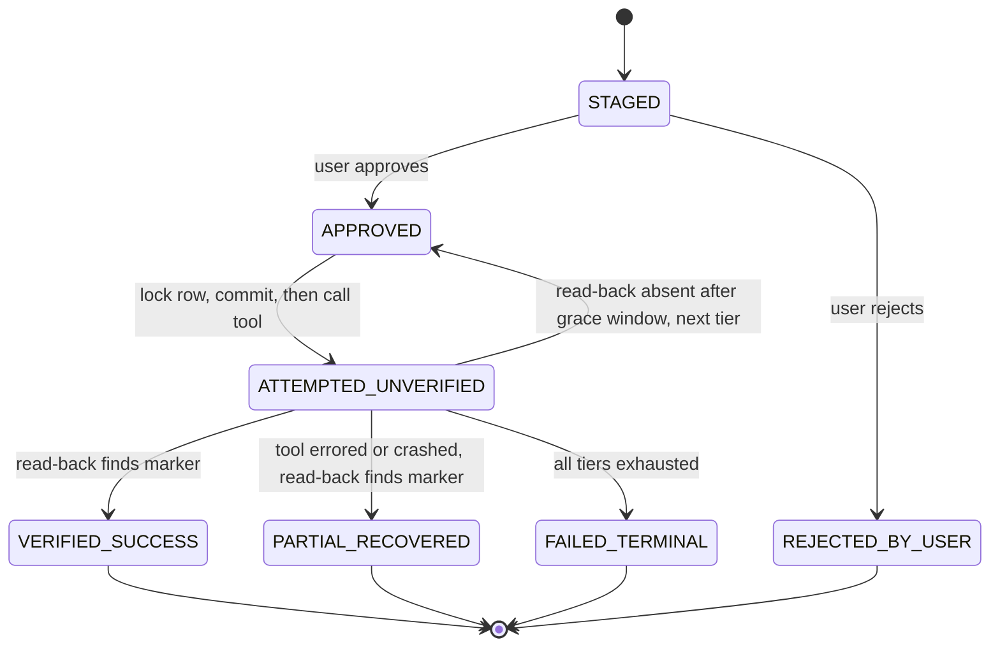

# Data flow

**Status:** proposed
**Last reviewed:** 2026-11-09

## Executor state machine (per staged action)

Transitions not shown are rejected by the ledger repository (`FR-013`).

## Data ownership

| Data | Store | Written by | Retention |
|---|---|---|---|
| Graph checkpoints | Postgres (`checkpoints*`) | LangGraph saver | Until thread archived |
| `verified_sources` | Postgres | Verifier | Per freshness window; audit kept |
| `execution_ledger` | Postgres | Staging, gate, executor | Immutable audit (no deletes) |
| `durable_memories` | Postgres + pgvector | Distiller | Until user deletes |
| Thread events | Valkey pub/sub | Worker | Ephemeral |
| Sandbox artifacts | Volume / object storage (S3-compatible, e.g. MinIO or Garage) | Tier 4 | Configurable |
| OAuth tokens | Encrypted at rest (Postgres, envelope key from secret) | Connector setup | Until revoked |
