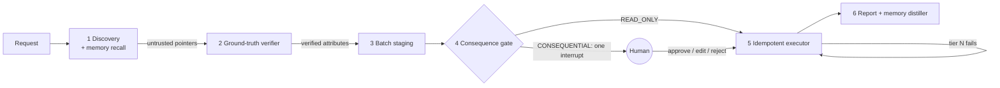

# Architecture overview

**Status:** proposed
**Scope:** Vouchor runtime and deployment
**Last reviewed:** 2026-11-09

## Context and drivers

Vouchor turns a natural-language request into a batch of verified, approved, read-back-confirmed actions. The architecture is driven by the six ATEP invariants ([blueprint](../vision/atep-blueprint.md)) and by three owner requirements: everything tested, everything runnable locally, and deployable to any cloud through FOSS IaC (`CON-001`, `CON-003`, `NFR-009`).

Key decisions: [ADR-002](../decisions/ADR-002-python-toolchain-and-quality-gates.md) toolchain, [ADR-003](../decisions/ADR-003-durable-orchestration-langgraph-dynamic-interrupt.md) orchestration, [ADR-004](../decisions/ADR-004-postgres-source-of-truth-valkey-for-coordination.md) state, [ADR-005](../decisions/ADR-005-versioned-migrations-alembic-sql.md) migrations, [ADR-006](../decisions/ADR-006-portable-deployment-kubernetes-helm-opentofu.md) deployment, [ADR-007](../decisions/ADR-007-provider-native-idempotency-markers.md) idempotency markers, [ADR-008](../decisions/ADR-008-tier4-sandbox-isolation-backends.md) sandbox.

## Boundaries and views

- Context: [system-context.md](system-context.md)
- Containers: [containers.md](containers.md)
- Components: [components.md](components.md)
- Data flow: [data-flow.md](data-flow.md)
- Trust boundaries: [security-and-trust-boundaries.md](security-and-trust-boundaries.md)

## The pipeline in one picture

## Quality attributes (priority order)

1. **Correctness of side effects** — no unapproved and no duplicate actions (`BR-001`, `NFR-004`).
2. **Durability** — every step checkpointed in Postgres (`FR-012`, `NFR-006`).
3. **Security and privacy** — sandboxing, least-privilege OAuth scopes, secrets outside Git (`NFR-007`, `BR-006`).
4. **Portability** — Compose locally, Helm everywhere else (`NFR-009`).
5. **Operability** — structured logs, OTel traces, health probes (`NFR-008`).

## Change and review

Owner: maintainer (STK-001). Review at every phase exit gate and whenever an ADR is added or superseded.
