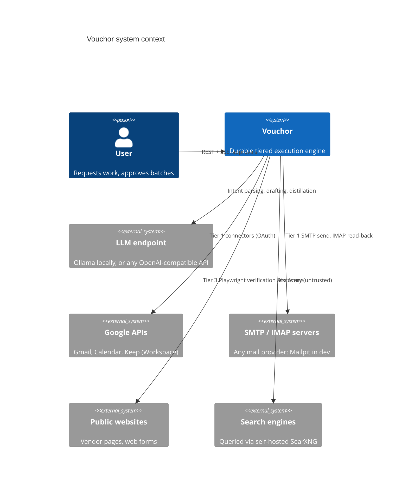

# System context

**Status:** proposed
**Last reviewed:** 2026-11-09

Everything inside the Vouchor boundary is self-hosted. External systems are reached only through MCP tool servers, so each can be faked in tests.
