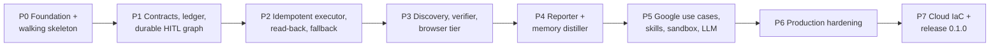

# Implementation plan

- **Status:** proposed (awaiting owner approval; no phase starts until approved)
- **Owner:** Maintainer (STK-001)
- **Last reviewed:** 2026-11-09
- **Inputs:** [product brief](product-brief.md), [requirements](requirements/functional-requirements.md), [architecture](architecture/overview.md), [ADRs](decisions/README.md), [documentation strategy](documentation-strategy.md)

## How this plan is executed

Each phase below becomes one CraftRail feature folder (`python3 scripts/new_feature.py "<phase title>"`) holding its `spec.md`, `plan.md`, `tasks.md` and `verification.md`. The folder's spec is approved by the owner before coding starts; the phase is closed only when **every exit-gate command passes and its evidence is recorded** in `verification.md`. A phase never starts with the previous gate red.

### Principles that make the plan watertight

1. **Walking skeleton first.** A health-only service is built, tested, containerised, deployed to Compose *and* to Kubernetes (kind) in Phase 0. Every later phase extends a pipeline that already reaches "deployed".
2. **Tests define done.** Each requirement is mapped to a test ID before implementation; acceptance tests from the blueprint are written first and start red.
3. **Fakes at every boundary.** LLM, MCP tools, clock and network are injected ports. Unit tests use fakes; integration tests use real local containers; nothing in CI needs a paid API or the public internet (except image pulls).
4. **Fault injection is a first-class feature.** Connectors accept a test-only `FaultPlan` (raise before send / after accept / after commit) so the exactly-once matrix (`NFR-004`) is deterministic.
5. **Docs converge per phase.** Tier 1, 2 and 3 docs are updated in the same PR as the code ([documentation strategy](documentation-strategy.md)).
6. **One command per gate.** `make check` (fast, also pre-commit), `make test-integration`, `make e2e`, `make k8s-test`, `make docs`.

## Definition of done (applies to every phase)

- [ ] Spec approved; tasks reference `FR/NFR/BR` IDs.
- [ ] `make check` green: Ruff, mypy strict, import-linter, unit tests + coverage thresholds, sqlfluff, hadolint, yamllint, shellcheck, actionlint, gitleaks, CraftRail validator.
- [ ] Phase integration/e2e suites green locally and in CI.
- [ ] Helm chart still installs on kind (`make k8s-test`) from Phase 0 onward.
- [ ] OpenAPI snapshot updated when the API changes; Schemathesis green.
- [ ] Tier 1/2/3 docs updated; `make docs` (strict site build) green.
- [ ] `verification.md` records commands, results and dates; CHANGELOG updated.

## Phase overview



| Phase | Blueprint mapping | Primary requirements | Exit gate (summary) |
|---|---|---|---|
| P0 | §3.1, §3.2 | NFR-001, 002, 007, 009, 010, 012 | Skeleton green in Compose, kind and CI |
| P1 | Phase 1 | FR-002, 009–013, 018 | 7 staged actions → 1 interrupt → resume; restart-safe |
| P2 | Phase 2 | FR-001, 003, 004, 013–017 | Exactly-once matrix: 0 duplicates |
| P3 | Phase 3 | FR-005–008 | Live value overrides stale snippet; Tier 3 form with read-back |
| P4 | Phase 4 | FR-020–023 | Memory holds facts only; next thread pre-populated |
| P5 | Beyond blueprint | FR-019, 024, 025 | Gmail, Calendar, Keep use cases pass against fakes; sandbox escape tests |
| P6 | Beyond blueprint | FR-026, NFR-004, 006, 008 | Worker split, auth, OTel, chaos tests |
| P7 | Beyond blueprint | NFR-009, CON-003 | `tofu apply` to kind and one cloud; tagged release |

---

## P0 — Foundation and walking skeleton

**Objective:** a repository where a trivial service is linted, typed, tested (unit + integration), containerised, run locally with Compose, deployed to a local Kubernetes cluster with Helm, and checked in CI.

**Tasks**

1. `pyproject.toml` (uv, Python 3.12, `src/vouchor/`), `uv.lock`; tool config for Ruff, mypy, pytest markers (`unit`, `integration`, `e2e`), coverage, import-linter. Keep CraftRail's `scripts/` tests running.
2. `Makefile` targets: `setup`, `check`, `test`, `test-integration`, `e2e`, `up`, `down`, `logs`, `migrate`, `k8s-up`, `k8s-test`, `k8s-down`, `docs`, `docs-serve`.
3. Extend `.pre-commit-config.yaml` with the hook set in [ADR-002](decisions/ADR-002-python-toolchain-and-quality-gates.md) plus commitizen `commit-msg`.
4. `src/vouchor/core/config.py` (pydantic-settings) and `api/main.py` with `/healthz` (liveness) and `/readyz` (checks Postgres and Valkey).
5. `Dockerfile` (multi-stage, uv, non-root, read-only rootfs) and `.dockerignore`.
6. `compose.yaml`: `postgres` (pgvector pg16, pinned), `valkey`, `mailpit`, `searxng` (JSON enabled, settings file), `migrate` (one-shot), `api`; profiles `llm` (LiteLLM + Ollama) and `observability` (Grafana LGTM). Healthchecks on everything; `.env.example`.
7. Alembic scaffold with an empty baseline revision ([ADR-005](decisions/ADR-005-versioned-migrations-alembic-sql.md)).
8. Test harness: `tests/unit`, `tests/integration` with session-scoped testcontainers fixtures (pgvector, Valkey, Mailpit), `tests/e2e` against Compose.
9. Helm chart `deploy/helm/vouchor` (api Deployment, Service, HTTPRoute, migrate hook Job, NetworkPolicies, PodSecurity `restricted`); values for kind. kind config + `ct` config.
10. CI (`.github/workflows/`): `quality` (pre-commit), `test` (unit + integration), `images` (build, Trivy, SBOM; push on `main`), `k8s` (kind + `ct install`), `docs` (strict Zensical build). Keep CraftRail `release.yml`.
11. Renovate config; dependency licence allow-list check.

**Exit gate**

```bash
make check                 # all linters, mypy strict, unit tests, coverage
make test-integration      # readiness test against real Postgres + Valkey containers
make up && curl -fsS localhost:8000/readyz && make down
make k8s-up && make k8s-test && make k8s-down
make docs
```

Plus: a fresh-clone job in CI reaches a running stack with `make setup up` (`NFR-010`).

**Risks:** Zensical beta (pinned, Markdown stays portable); Apple-silicon image builds (multi-arch in CI).

---

## P1 — Contracts, ledger and durable HITL graph

**Objective:** implement the data contracts and schema, and prove a batch suspends once at the gate in Postgres and resumes on approval.

**Tasks**

1. Migration `0001`: `verified_sources`, `execution_ledger` (+ `attempt_count` fencing, `lease_expires_at`, `payload_hash`), `durable_memories` (vector dimension from config), enums ([ADR-001](decisions/ADR-001-adopt-craftrail-and-atep-blueprint-with-amendments.md) A11). LangGraph `setup()` in the migrate job.
2. `core/contracts.py` per blueprint §2.3 with amendments A7 (conditional verification requirement). Hypothesis tests: idempotency key is deterministic, order-insensitive on payload keys, and changes when any field changes.
3. `core/ledger.py`: repository with a transition guard implementing the [state machine](architecture/data-flow.md); illegal transitions raise. Property-based test generates random transition sequences.
4. `orchestrator/registry.py` with load-time validation (`FR-002`).
5. `orchestrator/state.py`, `graph.py`; nodes as stubs for discovery/verifier driven by fixture data; real `staging` and `gate` (dynamic `interrupt()`, [ADR-003](decisions/ADR-003-durable-orchestration-langgraph-dynamic-interrupt.md)).
6. API: `POST /threads`, `GET /threads/{id}`, `GET /threads/{id}/actions`, `POST /threads/{id}/decisions` (approve / reject / edit per key). OpenAPI snapshot committed.

**Exit gate**

```bash
make check
uv run pytest tests/integration/test_p1_hitl_graph.py
```

`test_p1_hitl_graph.py` (blueprint Phase 1 gate, extended):

- 7 vendor outreach actions → graph pauses exactly once at `gate`; ledger has 7 `STAGED` rows (`FR-009`, `FR-010`).
- Approve 6, reject 1, edit 1 → ledger reflects `APPROVED` / `REJECTED_BY_USER`, edited row re-keyed (`FR-011`).
- Kill the app between interrupt and resume; new process resumes from checkpoint (`FR-012`).
- READ_ONLY-only batch never interrupts.
- Schemathesis run against the API.

---

## P2 — Idempotent executor, read-back and cascading fallback

**Objective:** exactly-once side effects for email via Tier 1 against Mailpit, with tier fallback.

**Tasks**

1. `tools/client.py`: MCP client wrapper; error taxonomy (`RetriableTierError`, `TierUnavailableError`, `TerminalToolError`); every exception becomes a `RouteAttempt` (`FR-003`).
2. `mcp_servers/tier1_connectors.py`: `send_smtp_email` (aiosmtplib, `Message-ID` marker per [ADR-007](decisions/ADR-007-provider-native-idempotency-markers.md)) and `verify_email_sent` (Mailpit API in dev; IMAP strategy behind an interface).
3. `mcp_servers/tier4_sandbox.py` (minimal): write `.eml` drafts to the artifacts directory (`FR-004`).
4. `nodes/executor.py`: the 5-step state machine with Postgres row claim + fencing token ([ADR-004](decisions/ADR-004-postgres-source-of-truth-valkey-for-coordination.md)), read-back-first on retry, grace-window polling, lease reclaim.
5. `FaultPlan` test hook (only importable when `VOUCHOR_ENV=test`).

**Exit gate** — `uv run pytest tests/integration/test_p2_idempotency_readback.py`:

| Scenario | Expected |
|---|---|
| Batch of 7 sends | 7 × `VERIFIED_SUCCESS`, Mailpit holds 7 messages |
| Timeout after SMTP accept (vendor #4) then retry | `PARTIAL_RECOVERED`, Mailpit holds **1** copy |
| Crash after send, before ledger update | Lease reclaim → read-back → `PARTIAL_RECOVERED`, 1 copy |
| Crash before send | Read-back absent after grace → resend → 1 copy |
| Two workers race on the same key | Exactly one sends; other skips |
| Tier 1 disabled for vendor #5 | Falls back; `route_history` records the reason; `.eml` artifact produced |
| Read-back never confirms | `FAILED_TERMINAL` after retries, error recorded |

Plus mutation testing on `executor.py` with surviving mutants reviewed (target ≥ 85% killed).

---

## P3 — Discovery, ground-truth verifier and browser tier

**Objective:** search results are pointers only; facts come from live pages; Tier 3 can fill forms with read-back.

**Tasks**

1. `nodes/discovery.py`: SearXNG client returning `UntrustedPointer` (a distinct type that cannot be passed where `VerifiedAttribute` is expected — enforced by mypy and a runtime check in staging) (`FR-005`).
2. `mcp_servers/tier3_browser.py` (Playwright async, Crawl4AI for extraction): `verify_live_page_fact`, `execute_browser_form` with indexed interactive elements and post-submit DOM capture.
3. `nodes/verifier.py`: live verification, discrepancy logging (`FR-007`), freshness windows (`FR-008`).
4. Test fixture app: local FastAPI "mock vendor storefront" (contact page, form, confirmation page) started per test session.
5. Prompt-injection fixtures: pages containing instructions aimed at the agent; assert they never change capability, consequence or recipients.

**Exit gate** — `uv run pytest tests/integration/test_p3_verifier_fallback.py`: stale snippet `sales@example.com` overridden by live `parts@example.com` with discrepancy logged; Tier 3 form submission verified by DOM read-back; injection fixtures produce no unapproved action.

---

## P4 — Plain reporter and selective memory distiller

**Objective:** honest reports from the ledger; memory holds only durable facts.

**Tasks**

1. Reporter: ledger → structured summary → plain-English text; golden-file tests (`FR-020`).
2. Distiller: strict structured-output prompt → `list[DurableFactCandidate]`; noise-filter guardrail (`FR-021`, `BR-004`); fake LLM returns crafted noisy candidates in tests.
3. Embeddings via LiteLLM (`nomic-embed-text`) with a deterministic hash-embedding fake for tests; cosine dedupe > 0.92 (`FR-022`).
4. Discovery loads top-K memories (`FR-023`).

**Exit gate** — `uv run pytest tests/integration/test_p4_memory_distillation.py`: after a 7-store run, memory holds the 7 verified contact emails and the user's formatting preference, zero execution steps; a second thread starts with those facts and asks no redundant question. Report text matches ledger counts exactly.

---

## P5 — Real-world use cases, skills, sandbox and live LLM path

**Objective:** deliver the Tier 2 documentation use cases end to end and harden Tiers 2 and 4.

**Use cases** (each = capability + tests + Tier 2 guide page):

| Use case | Capability | Consequence | Tiers | Read-back |
|---|---|---|---|---|
| Send an email with Gmail | `send_email` | CONSEQUENTIAL | 1 Gmail API → 1 SMTP → 3 browser → 4 `.eml` | `rfc822msgid` search |
| Read / search / summarise email | `search_email`, `read_email` | READ_ONLY | 1 Gmail API → 1 IMAP | n/a |
| Schedule a Google Calendar event | `create_calendar_event` | CONSEQUENTIAL | 1 Calendar API → 4 `.ics` | `events.get(id)` |
| Add a note to Google Keep | `create_note` | CONSEQUENTIAL | 1 Keep API (Workspace) → 3 browser → 4 `.md` | label / DOM search |
| Vendor outreach (blueprint scenario) | `vendor_outreach` skill | CONSEQUENTIAL | 2 playbook composing the above | per step |

**Tasks**

1. Google OAuth installed-app flow (`vouchor connect google`), token encryption at rest, minimal scopes (`BR-006`).
2. Google connectors in `tier1_connectors.py`; tests use recorded-contract fakes (a local fake Google API server built from the published discovery documents) — no real Google calls in CI. An opt-in `live` marker runs against the owner's test account.
3. `tier2_skills.py`: playbooks as typed DAGs of capabilities.
4. Sandbox backends `docker` and `kubernetes` ([ADR-008](decisions/ADR-008-tier4-sandbox-isolation-backends.md)); escape-attempt tests (network, filesystem, fork bomb, timeout).
5. Live LLM path through LiteLLM + Ollama; LLM evaluation set for intent parsing (non-blocking CI report).
6. SSE endpoint `GET /threads/{id}/events` via Valkey pub/sub (`FR-019`); minimal CLI client `vouchor` (`typer`) to create threads and approve batches.

**Exit gate:** `make test-integration` and `make e2e` cover every use case against fakes/Mailpit; sandbox escape suite green; Tier 2 guide pages each have a runnable walkthrough verified by an e2e test.

---

## P6 — Production hardening

1. Split `worker` from `api`; Procrastinate queue on Postgres ([ADR-003](decisions/ADR-003-durable-orchestration-langgraph-dynamic-interrupt.md)).
2. API authentication (OIDC via any provider, or static API tokens for single-user installs); approvals bound to thread owner (`FR-026`).
3. OpenTelemetry traces/metrics/logs with `thread_id` and `idempotency_key` attributes (`NFR-008`); Grafana dashboards as code.
4. Chaos tests: kill worker mid-execution, restart Postgres, drop Valkey — assert `NFR-004` and `NFR-006`.
5. Rate limiting, request size limits, audit-log export, backup/restore runbook.

**Exit gate:** chaos suite green; trace assertions green; restore drill documented with evidence.

---

## P7 — Cloud infrastructure and first release

1. OpenTofu modules per [ADR-006](decisions/ADR-006-portable-deployment-kubernetes-helm-opentofu.md): `cluster-local-kind`, `cluster-hetzner-k3s` (first cloud target; cheapest single-VM path), `platform` (CloudNativePG with S3 backups, Valkey, SearXNG, LiteLLM, Vouchor chart, Gateway API, cert-manager).
2. `infra/envs/local` applied in CI; `infra/envs/staging` applied manually by the owner.
3. TFLint, `tofu validate`, Trivy config scan in CI.
4. Release workflow: on `v*` tag build multi-arch images, SBOM, sign, publish chart to OCI registry, GitHub Release notes.

**Exit gate:** `tofu apply` in `envs/local` produces a working cluster passing the e2e suite; owner applies `envs/staging` on one cloud and records evidence; `v0.1.0` tag released.

---

## Cross-phase risk register

| Risk | Impact | Mitigation | Phase |
|---|---|---|---|
| LangGraph / FastMCP API changes | Rework | Pin versions; adapters isolate them | All |
| Local LLM quality | Wrong intents | Deterministic playbooks; structured outputs; human gate catches errors | P3–P5 |
| Third-party site changes break Tier 3 | Failed actions | Tier fallback; contract tests on fixtures; Tier 3 opt-in | P3, P5 |
| Google API quotas / verification for OAuth apps | Demo friction | User brings own OAuth client; documented in Tier 2 | P5 |
| Exactly-once edge cases | Duplicate emails | Fault matrix + mutation testing + chaos tests | P2, P6 |
| Scope creep | Delay | Each phase has a spec approved before work; extras go to ROADMAP | All |

## Open decisions for the owner

1. Approve the product name **Vouchor** and the AGPL-3.0-or-later licence ([ADR-009](decisions/ADR-009-license-agpl-3-0-or-later.md)).
2. Approve ADR-001 to ADR-009 (all `proposed`).
3. First cloud target for P7 (proposed: Hetzner + k3s for cost; AWS EKS module as second).
4. Whether Phase 5 includes a minimal web UI for approvals or stays CLI + API for v0.1.
