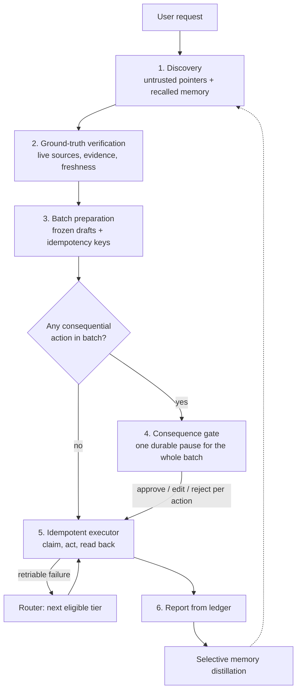

# Autonomous Tiered Execution Platform (ATEP) — architecture vision

- **Status:** historical vision input, refined
- **Last reviewed:** 2026-11-09
- **Owner:** Maintainer (STK-001)
- **Related:** [ADR-001](../decisions/ADR-001-adopt-craftrail-and-atep-blueprint-with-amendments.md), [functional requirements](../requirements/functional-requirements.md), [business rules](../requirements/business-rules.md), [architecture overview](../architecture/overview.md)

!!! note "How to read this page"
    This page describes **what** ATEP must guarantee and **why**. It does not choose languages, frameworks, databases, schemas or file layouts; those choices live in the [ADRs](../decisions/README.md) and may change without changing this vision.

    Where this page and an ADR disagree, the ADR wins. Each invariant below ends with a **critical review** of where the original idea is weak or overstated. Those critiques are open questions for the owner. They do not change any requirement until a requirement or ADR is updated.

    The original, technology-specific blueprint (with SQL DDL, Python models, a fixed repository layout and coding-agent prompts) is kept in Git history at commit `ac5b91d` (`docs/project/vision/atep-blueprint.md`). ADR-001's amendment table quotes that version.

## 1. Problem

Most agent frameworks run tool calls as a best-effort loop: the model decides, a tool fires, and the loop continues. In production this produces four recurring failures:

1. **Acting on stale or wrong facts.** Search snippets, cached pages and model recall are treated as current truth.
2. **Badly timed human involvement.** The user is asked either for every trivial step or not at all before something irreversible happens.
3. **Confusing "called" with "done".** A successful response, a `200 OK` or a click event is reported as proof that the outcome happened in the world.
4. **Memory that degrades over time.** Execution chatter, drafts and retries are written into long-term memory and later recalled as if they were facts.

ATEP is a durable execution engine designed around these failures. It aims to turn a natural-language request into a batch of actions that are **verified before preparation, approved before execution, and proven after execution**.

## 2. Scope and non-goals

**In scope:** batches of outward-facing tasks for a single user: finding and verifying contacts, sending messages, creating calendar entries and notes, filling web forms, and producing local files when direct action is impossible.

**Out of scope for this vision:**

- Payments, purchases, trades and fund transfers (`BR-005`).
- Open-ended conversational assistance with no external effect.
- Hosted multi-tenant service operation. The engine is self-hosted (`CON-001`); multi-user authentication is a later concern (`FR-026`).
- Guaranteeing outcomes on systems that offer no way to observe them (see §6, invariant 5).

## 3. Core concepts

These are logical concepts. How they are stored is an implementation decision.

| Concept | Meaning | Key properties |
|---|---|---|
| **Request / thread** | One user intent and everything done to satisfy it | Durable identity; survives restarts; can wait for days |
| **Capability** | A named outcome the system can produce, such as `send_message` or `create_event` | Consequence class; whether it needs verified inputs; one or more tier handlers; a read-back method for every handler that changes external state |
| **Tier handler** | One way to carry out a capability, at a given tier | Health/availability; error taxonomy (retriable vs terminal) |
| **Discovery pointer** | A candidate fact from search or recall | Always untrusted; never usable as an input to an action |
| **Verified attribute** | A fact about an entity, confirmed against a live source | Entity, attribute, value, source, method, raw evidence, observed-at time, freshness window |
| **Staged action** | A fully prepared, not-yet-executed action | Exact payload; target; verified inputs it depends on; human-readable summary; idempotency key |
| **Ledger entry** | The authoritative record of a staged action's lifecycle | Status, attempt history, tier route history, read-back proof, errors |
| **Durable fact** | Knowledge worth remembering across threads | Category (preference, decision rule, verified entity fact), provenance, confidence, expiry |
| **Report** | The user-facing summary when a thread ends | Derived only from ledger entries, never from model narration |

### Idempotency key

Every staged action has a deterministic key computed from the thread identity, the capability, the target and the **canonical serialization** of the frozen payload. Two requirements make this language-agnostic and stable:

- The serialization must be a published canonical form (for example RFC 8785 JSON Canonicalization), not "whatever the runtime's JSON encoder does".
- The payload must be frozen at staging. A model must never regenerate a draft during retry, or the key changes and duplicate protection is lost.

## 4. Execution tiers

Capabilities are carried out through four kinds of handler, ordered from most to least predictable:

| Tier | Kind | Typical example | Observability of outcome |
|---|---|---|---|
| 1 | **Direct connector:** a typed protocol or API integration | Mail submission, calendar API | Usually strong (IDs, queries) |
| 2 | **Deterministic skill:** a predefined multi-step playbook | "Contact N vendors" built from tier-1 calls | Inherits from its steps |
| 3 | **Live browser automation:** a real browser driven through the accessibility tree | Web contact form | Often weak (confirmation page only) |
| 4 | **Isolated sandbox:** generated code in a locked-down environment | Build a `.csv`, `.eml` or `.ics` file | Strong for the artifact; **no external effect** |

## 5. System flow

Logical components and their single responsibilities:

| Component | Responsibility |
|---|---|
| Gateway | Accept requests, expose thread state and approvals, stream progress |
| Orchestrator | Run the flow as a durable, resumable state machine with checkpoints |
| Capability registry and router | Map capabilities to tier handlers; pick the first eligible handler; enforce declaration rules at load time |
| Verifier | Turn discovery pointers into verified attributes, or reject them |
| Stager | Produce frozen drafts and staged actions for every target before any approval |
| Consequence gate | Pause once per batch when needed; apply per-action decisions |
| Executor | Run each approved action exactly as approved, with claim, fencing and read-back |
| Reporter | Summarize outcomes from ledger entries only |
| Distiller | Extract durable facts; discard execution noise |
| Tool servers | Host tier handlers behind a standard tool protocol (for example MCP) so they can be replaced independently |

## 6. The six invariants

The original blueprint numbered these "Rule 3" to "Rule 8", which shows they were lifted out of a longer list whose first two rules were never written down. They are renumbered 1–6 here, matching the requirements.

### Invariant 1 — Cascading tiered routing

**Statement.** A capability is attempted on the most predictable eligible tier first. A retriable failure is recorded and the next eligible tier is tried before the system reports that it cannot do the task.

**Why.** Typed integrations fail loudly and can be verified. Browsers and generated code are more capable but less predictable. Trying the predictable path first reduces both risk and cost.

**Critical review.**

- **Falling back can change what the user approved.** Approving "send via the mail API" is not the same as approving "type it into a web form as you". A tier change after approval changes the channel, the visible sender and the read-back strength. *Open question:* should approval name the allowed tiers, or should a post-approval tier change go back to the gate?
- **Not every error should cause a fallback.** The original lists HTTP 403 as a reason to fall back. A 403 usually means "you are not permitted". Getting around it with a browser circumvents authorization, which is a security and terms-of-service problem rather than a resilience feature. The error taxonomy must separate *unavailable* (fall back), *forbidden* (stop) and *invalid input* (stop and report).
- **Tier 2 is a composition, not an alternative.** A skill made of tier-1 calls cannot sensibly be the fallback for those same calls. Tiers describe handler kinds; fallback order should be declared per capability, not assumed from the tier number.
- **Tier 4 is not execution.** Producing a draft file when sending failed is useful, but the outcome is "not done, here is what you need". It must never be counted as success (`FR-004`, `BR-003`).
- **Browser automation of third-party sites** raises rate-limit, bot-detection and terms-of-service issues that a fallback rule does not address.

### Invariant 2 — Ground-truth verification before action

**Statement.** Search results and recalled facts are untrusted discovery pointers. Every attribute an action depends on must be confirmed from a live source and stored with its source, method, raw evidence and observation time before preparation.

**Why.** Snippets and caches go stale. Acting on them sends messages to dead addresses and wrong vendors.

**Critical review.**

- **"Live" does not mean "true".** A live page can be spoofed, compromised, SEO spam or a reseller pretending to be the vendor. Verification proves provenance and freshness, not correctness. Source authority (an official domain or an authenticated API) should be part of what counts as verified.
- **Live pages are a prompt-injection channel.** Text taken from a page goes into drafts and into the model's context. Evidence must be handled as data, and extracted values validated against the attribute's expected shape, before a model sees them.
- **Evidence-length checks are theatre.** A minimum snippet length (the original used five characters) proves nothing. What matters is that the evidence contains the value and can be traced to the source.
- **Freshness was missing from the original.** It recorded a timestamp but no expiry. Attributes need a per-type freshness window, and that window must be checked again **at execution time**, because approval can come days after verification (`FR-008`).
- **Not every action has something to verify.** A note to yourself or a local artifact depends on no external entity. Requiring at least one verified input everywhere forces fake verification (ADR-001 A7).

### Invariant 3 — Upfront batch preparation

**Statement.** Read-only discovery, verification and drafting finish for every target in a batch before the human is asked anything.

**Why.** One informed decision over a complete batch beats a trickle of interruptions.

**Critical review.**

- **Batching invites rubber-stamping.** Seven drafts on one screen get less scrutiny than one. The gate UI must make differences between drafts and risky items obvious, and approval must stay per action (`FR-011`).
- **Some batches cannot be fully prepared upfront**, for example when a later step depends on an earlier reply. The vision should allow multi-stage batches, each with its own gate, rather than pretend everything is known at the start.
- **Preparation costs money and time.** Verifying fifty targets before the user can say "only the first three" wastes work. A cheap preview step before full verification may be worth adding.

### Invariant 4 — Consequence-gated human approval

**Statement.** Every capability is classified as read-only or consequential. If a batch contains any consequential action, the flow pauses durably at a single gate that shows every draft with its verified inputs. Nothing consequential runs without explicit approval, and it runs with exactly the approved payload (`BR-001`, `BR-002`).

**Why.** It puts the human at the one point where their judgment matters, and only there.

**Critical review.**

- **Two classes are too coarse.** Reversible vs irreversible, private vs public, cost and audience size all matter. A note to yourself and an email to a customer are both "consequential" but carry very different risk. *Open question:* add a severity or reversibility dimension that can drive UI emphasis or auto-approval policies later.
- **Consequence depends on parameters, not only on the capability.** "Create event" with only the user as attendee is harmless; with external attendees it sends invitations. Classification may need to be evaluated per staged action.
- **"Read-only" has side effects too.** Opening a page can trigger tracking, unsubscribe links or "mark as read". Sending private data to a remote model endpoint is a disclosure (`BR-006`). Browser navigation and remote inference should be treated with that in mind.
- **Approval goes stale.** An approval given days later against expired verification should require re-verification and, if values changed, re-approval.

### Invariant 5 — Idempotent execution and read-back verification

**Statement.** Executing is not completing. Every consequential action has a deterministic idempotency key and an out-of-band read-back method. On any uncertain outcome (crash, timeout, error) the executor runs read-back **before** retrying, so a side effect that already happened is recorded and not repeated.

**Why.** Networks fail after the remote side has accepted a request. Without read-back, the safe-looking retry is the one that sends the duplicate.

**Critical review.**

- **"Zero duplicate side effects" is overstated.** Exactly-once effects on a system you do not control are impossible in general. ATEP can offer *at-most-once with reconciliation* where the target supports a unique marker or a client-chosen ID (ADR-007), and *best effort* elsewhere. The claim should be scoped per capability.
- **Absence is not proof.** Many systems are eventually consistent, so an immediate "not found" can be wrong. Read-back needs a grace window before absence counts (ADR-001 A3).
- **There must be an "unknown" outcome.** When read-back is impossible or keeps failing, the honest state is "outcome unknown, human must check". The original state machine has no such state, so it forces either a false success or a risky retry.
- **Matching must be exact.** Read-back by "same recipient and subject" matches the wrong message. Stamp a marker derived from the idempotency key into the side effect wherever the target allows (ADR-007).
- **Weak read-back on tier 3.** Re-scraping a page after submitting a form usually proves nothing. Browser-tier capabilities should declare their read-back strength, and the report should state it.
- **Concurrency.** Two workers must never run the same key at once. The claim must sit in the same transactional store as the ledger, with fencing, not in a separate lock service whose locks can expire mid-call (ADR-004).
- **The status names are misleading.** "Partial recovered" means "succeeded, confirmed only on reconciliation", which is neither partial nor a recovery. Clearer names would help reports.

### Invariant 6 — Plain reporting and selective memory

**Statement.** When a thread ends, the report is derived from the ledger, not from model narration. A separate step keeps only durable facts (preferences, decision rules, verified entity facts) and discards drafts, page state and retry logs (`BR-004`).

**Why.** Users need an honest account. Memory polluted with execution noise makes later threads worse.

**Critical review.**

- **The "immutable audit ledger" was mutable.** The original described an immutable ledger but updated rows in place. Real auditability needs an append-only event history, with the current status derived from it or maintained alongside it.
- **Report claims must match what was measured.** "0 duplicates" can only honestly be "0 duplicates detected" when read-back is best effort.
- **Remembered entity facts become discovery pointers again.** A vendor email remembered last month is exactly the stale fact invariant 2 forbids acting on. Recalled facts must carry provenance and expiry, and must be re-verified before use.
- **Keyword noise filters are brittle.** Rejecting candidates that contain words like "clicked" or "retried" misses paraphrases and blocks legitimate facts. Model-assigned confidence scores are uncalibrated, and a fixed similarity threshold (the original used 0.92) depends on the embedding model. These are tunable defaults, not rules.
- **Users must control memory.** They need to inspect, correct and delete what is remembered. Without that, selective memory becomes a privacy liability.

## 7. Infrastructure capabilities required

The vision needs these capabilities, not specific products. Product choices and their trade-offs are recorded in ADRs.

| Capability | Why it is needed | Decided in |
|---|---|---|
| Durable, transactional state store | Ledger, checkpoints, verified attributes and memory must survive crashes; claims and status changes must be atomic | [ADR-004](../decisions/ADR-004-postgres-source-of-truth-valkey-for-coordination.md), [ADR-005](../decisions/ADR-005-versioned-migrations-alembic-sql.md) |
| Durable workflow runtime with pause/resume | Threads wait for approval for days and must survive restarts | [ADR-003](../decisions/ADR-003-durable-orchestration-langgraph-dynamic-interrupt.md) |
| Similarity search over facts | Deduplicating and recalling durable facts | ADR-004 (store), migration-time dimension (ADR-001 A11) |
| Ephemeral messaging | Progress streaming and rate counters; losing it must never affect correctness | ADR-004 |
| Self-hostable metasearch | Discovery without paid APIs (`CON-001`) | Implementation plan |
| Headless browser | Live verification and tier-3 handlers | Implementation plan |
| Isolated execution environment | Tier 4 without privileged containers | [ADR-008](../decisions/ADR-008-tier4-sandbox-isolation-backends.md) |
| Model gateway | Local-first inference with optional compatible endpoints (`CON-004`) | Business rules |
| Local test doubles for external systems | Deterministic, offline tests for send, read-back and fault injection | Implementation plan |

## 8. Gaps the original did not address

These cut across invariants and have no owner yet. Each should become a requirement, an ADR or an explicit non-goal.

| Gap | Why it matters |
|---|---|
| Credential and secret handling | Connectors act in the user's name; token storage, scope minimization and revocation are central to trust |
| Prompt injection as a threat model | Pages, emails and search results all flow into model context and drafts (see [security and trust boundaries](../architecture/security-and-trust-boundaries.md)) |
| Cancellation, deadlines and timeouts | A user must be able to stop a running batch; approvals and verifications need expiry |
| Observability | Operators need traces across verify → gate → execute → read-back to debug "unknown" outcomes |
| Rate limiting and politeness | Verification and browser handlers hit third-party sites; uncontrolled fan-out gets the user blocked |
| Legal and terms-of-service limits on automation | Some targets prohibit automated access; fallback to the browser can breach those terms |
| Evaluation of model-dependent steps | Extraction, drafting and distillation quality need measurable checks, not only structural tests |

## 9. What the original got wrong as a document

For the record, so the same pattern is not repeated in specs:

- **It mixed vision with implementation.** DDL, class definitions, library lists and exact directory trees fixed decisions before any trade-off was examined. Several were later found to be wrong (ADR-001 A1–A11).
- **It prescribed one coding agent.** Instructions to save the file as an agent-specific config and feed it prompts phase by phase belong in a workflow, not in an architecture. This repository's workflow is agent-neutral ([CraftRail](../../framework/workflow.md)).
- **Its tests used a real business name.** Scenarios should use fictional entities.
- **It overclaimed.** "Guarantee zero duplicate side effects" and "immutable ledger" were stated as properties the design did not have.
- **Typos and orphaned numbering** ("Rule 3"–"Rule 8") suggested unedited generated text.

## 10. Traceability

| Invariant | Requirements | Decisions |
|---|---|---|
| 1 Tiered routing | `FR-001`–`FR-004`, `FR-025` | ADR-008 |
| 2 Ground-truth verification | `FR-005`–`FR-008` | ADR-001 A7 |
| 3 Batch preparation | `FR-009` | ADR-003 |
| 4 Consequence gate | `FR-010`–`FR-012`, `BR-001`, `BR-002`, `BR-005`, `BR-006` | ADR-001 A1, ADR-003 |
| 5 Idempotency and read-back | `FR-013`–`FR-017`, `BR-003` | ADR-001 A2–A4, A8, ADR-004, ADR-007 |
| 6 Reporting and memory | `FR-020`–`FR-023`, `BR-004` | ADR-001 A11 |

## 11. Open questions for the owner

1. Must a tier change after approval go back to the gate, or can approval name the allowed tiers?
2. Should the action lifecycle gain an explicit "outcome unknown, needs human" state?
3. Should consequence gain a second dimension (severity or reversibility), and should it be evaluated per action rather than per capability?
4. Should the ledger become append-only events, with status derived from them?
5. Should recalled entity facts always be re-verified before use, or only once they pass their freshness window?
6. Which gaps in §8 belong in v1, and which are explicit non-goals?
