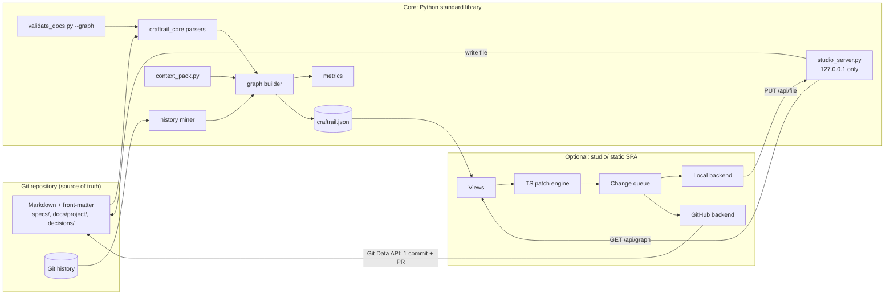
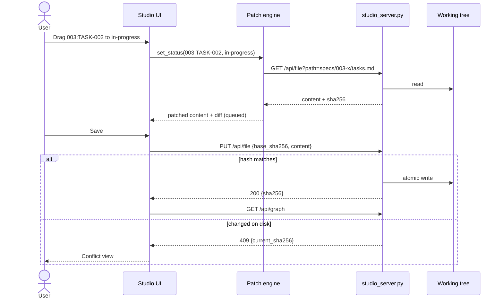

# Technical plan: NNN CraftRail Studio

- **Status:** proposed
- **Related spec:** [spec.md](spec.md)
- **Decision:** [ADR-001](ADR-001-craftrail-studio-git-native-static-studio.md)

## Proposed solution and alternatives

Two halves joined by one JSON contract:



Reads are implemented in Python (exporter) because CI, agents and validation need them without Node. Writes are implemented once, in TypeScript (patch engine), because only the UI edits. The local server is a thin, safe file gateway. A shared fixture corpus keeps the Python reader and TypeScript writer consistent: `export(apply_patch(file)) == expected`.

Alternatives are recorded in [ADR-001](ADR-001-craftrail-studio-git-native-static-studio.md).

## Impacted components and interfaces

### Repository layout (additions)

```text
scripts/
  craftrail_core/            # new stdlib package (imported by CLIs and validator)
    __init__.py
    frontmatter.py           # restricted YAML profile parser + serializer helpers
    legacy_meta.py           # "- **Key:** value" block reader
    md_tables.py             # GFM table tokenizer (escaped pipes, inline code)
    declarations.py          # declaration bullets in spec.md
    items.py                 # Item, Link, Diagnostic dataclasses; canonical keys
    resolve.py               # reference resolution, feature-local scoping
    statuses.py              # vocabularies, note parsing "verified (illustrative)"
    links.py                 # link extraction rules
    history.py               # git CLI mining, rename following, cache
    metrics.py               # metric computations (pure functions over events)
    graph.py                 # assemble + deterministic JSON serialization
    config.py                # .craftrail/studio.json loading + defaults
    context.py               # context pack algorithm
  export_graph.py            # CLI
  migrate_frontmatter.py     # CLI
  context_pack.py            # CLI
  studio_server.py           # CLI, http.server-based
  validate_docs.py           # gains --graph (uses craftrail_core)
  new_feature.py             # writes front-matter, global requirement IDs
contracts/                   # or docs/framework/contracts/ — maintainer choice
  craftrail-graph.schema.json
  craftrail-frontmatter.schema.json
templates/feature/*.md       # gain front-matter
studio/                      # optional SPA (Node toolchain isolated here)
  package.json, pnpm-lock.yaml, vite.config.ts, tsconfig.json, biome.json
  src/
    data/        loadGraph.ts, types.gen.ts (generated from JSON Schema)
    views/       Overview, Board, Traceability, ItemDetail, Metrics, Decisions, Search
    patch/       frontmatter.ts, tables.ts, declarations.ts, ops.ts, diff.ts
    backends/    Backend.ts (interface), local.ts, github.ts
    context/     pack.ts, prompts.ts
    validate/    schema.ts (Ajv), rules.ts
  tests/         vitest unit + playwright e2e
tests/
  fixtures/shared/           # used by BOTH unittest and vitest
  fixtures/make_fixture_repo.py  # builds deterministic git repos with scripted history
  test_frontmatter.py, test_tables.py, test_export.py, test_history.py,
  test_metrics.py, test_context.py, test_server.py, test_migrate.py, test_new_feature_ids.py
.github/workflows/studio.yml   # optional template workflow
```

### Studio stack (all OSI-licensed, pinned via `pnpm-lock.yaml`)

| Concern | Choice | Why |
|---|---|---|
| Build | Vite, TypeScript strict | Fast, static output, base-path aware |
| UI | React | Ecosystem for graph and accessible components |
| Graph | `@xyflow/react` (React Flow) + `dagre` layout | MIT, handles 1,000+ nodes, keyboard support |
| Charts | uPlot | About 50 KB, fast, fits the bundle budget |
| Routing | `wouter` with hash location | Tiny, works under any sub-path without server rewrites |
| State | Zustand | Small store for graph, filters and change queue |
| Markdown | `markdown-it` + DOMPurify | Sanitised rendering of excerpts |
| Validation | Ajv (JSON Schema 2020-12) | Same contracts as Python side |
| Diff | `diff` (jsdiff) | Unified diff preview in change queue |
| Lint/format | Biome | One tool, fast |
| Tests | Vitest + Testing Library, Playwright, `@axe-core/playwright`, MSW | Unit, e2e, accessibility, GitHub API mocking |

Types in `src/data/types.gen.ts` are generated from the graph schema (`json-schema-to-typescript`). CI fails if the generated file is stale.

### Local server API

All endpoints require header `X-CraftRail-Token` and a matching `Origin`/`Host` (`http://127.0.0.1:<port>`).

| Method | Path | Request | Response | Errors |
|---|---|---|---|---|
| GET | `/` and static assets | — | built app from `--app-dir` (default `studio/dist`) | 404 with build instructions if missing |
| GET | `/api/graph` | `?history=0\|1` | `craftrail.json` content (fresh export, cached by HEAD + dirty-file hashes) | 500 with diagnostics |
| GET | `/api/file` | `?path=<repo-relative>` | `{path, sha256, content}` | 403 outside globs, 404 missing |
| PUT | `/api/file` | `{path, base_sha256, content}` (at most 2 MB) | `{path, sha256}` | 403 outside globs or symlink; 409 hash mismatch with `{current_sha256}`; 413 too large |
| GET | `/api/health` | — | `{ok, repo_root, git: bool}` | — |

Startup prints `Studio: http://127.0.0.1:<port>/#token=<token>`. With `--open`, the server opens the browser. Writes are atomic (temp file + `os.replace`) and preserve the file's newline style.

### GitHub backend flow

1. `GET /repos/{o}/{r}` → default branch. `GET /git/ref/heads/{base}` → base commit SHA.
2. For each queued file: `GET /contents/{path}?ref={base}` to compare blob SHA with the SHA loaded at view time. On mismatch → conflict view (`FR-026`).
3. `POST /git/blobs` per file → `POST /git/trees` (base_tree = base commit tree) → `POST /git/commits` → `POST /git/refs` (`refs/heads/studio/<YYYYMMDD>-<slug>`).
4. `POST /pulls` with a body that lists every operation and its item keys. If the queue contains an approval change, the PR is mandatory and labelled `approval`.
5. Handle 401/403 (scopes message), 404 (repo access), 409/422 (ref exists → add suffix), and secondary rate limits (show retry-after; no automatic loop).

## Data and migration

- **Graph JSON** is versioned (`schema_version: "1.0"`). Studio refuses a major version it does not know and warns on a newer minor.
- **Migration path for existing repositories:**
  1. Ship parsers with legacy support. `--graph` validation is opt-in.
  2. Run `migrate_frontmatter.py` in the CraftRail repository itself; templates gain front-matter.
  3. In the next minor release, graph validation becomes default, and legacy-only metadata stays a warning.
  4. Two minor releases later, legacy-only metadata becomes an error under `--strict`.
- `new_feature.py` ID change: the default becomes global requirement numbering; `--local-requirement-ids` keeps the old behaviour for one minor release.
- **Rollback:** removing `studio/` and the new scripts restores the previous behaviour. Front-matter is valid Markdown, and GitHub and Zensical render it, so migrated files stay readable.

## Diagrams

- Component and data flow: above.
- Edit sequence (local mode):



Review date for diagrams: at each milestone exit.

## Security and trust boundaries

| Boundary | Threat | Control |
|---|---|---|
| Browser ↔ local server | Other local processes or web pages issuing requests (DNS rebinding, CSRF) | Loopback bind, `Host` and `Origin` checks, random token in header (from fragment), no CORS, no cookies |
| Local server ↔ filesystem | Path traversal, writing source code | Repo-relative paths only, `realpath` inside repo root, symlink rejection, glob allow-list (`BR-003`), size limit |
| Studio ↔ GitHub | Token theft, over-privileged tokens | Fine-grained PAT, single repository, minimal scopes, memory-only by default, CSP `connect-src 'self' https://api.github.com` |
| Rendered Markdown | XSS from repository content | `markdown-it` with `html: false` + DOMPurify; no `dangerouslySetInnerHTML` without sanitiser |
| Prompts | Prompt injection from artifact text into agents | Packs are plain data with the source paths; the prompt tells the agent to read sources; no automatic execution |

## Errors, retries, idempotency, and consistency

- **Parsing:** errors are per file and never global (`FR-013`).
- **Exporter:** deterministic output, so it is idempotent. The cache is rebuilt on ancestry mismatch. Git command failures surface as diagnostics, and the run continues without history.
- **Saves:** optimistic concurrency. Local writes are atomic. GitHub writes are one commit per save, and retrying a failed save after a partial ref creation reuses the existing branch only if its head equals the commit Studio created. Otherwise Studio creates a new suffixed branch.
- **Patch application is deterministic:** the same operation on the same input always gives the same output (tested on fixtures).

## Operations and rollout

| Milestone | Content | Exit |
|---|---|---|
| M1 Conventions | front-matter profile, legacy reader, tables, identity, statuses, `--graph`, migration tool, template + `new_feature.py` changes | `AC-001`–`AC-007` |
| M2 Exporter | items, links, history, cache, metrics, diagnostics, determinism, context pack CLI | `AC-008`–`AC-014`, `AC-027` (Python half) |
| M3 Read-only Studio | app shell, data loading, all views, search/URL state, metrics charts, accessibility | `AC-015`–`AC-020`, `AC-030` |
| M4 Local editing | patch engine, change queue, validation, local server, conflicts, approval guard | `AC-021`, `AC-022`, `AC-024`–`AC-026` |
| M5 GitHub editing and prompts | GitHub backend, copy prompt, TS context pack parity | `AC-023`, `AC-027`, `AC-028` |
| M6 Hosting and release | `studio.yml`, sub-path build, CSP, bundle and perf budgets, docs, release asset | `AC-029`, `AC-031` |

Docs to add (CraftRail docs site):
- `docs/framework/studio.md`: what it is, local mode, hosting, editing, metrics definitions, limits;
- updates to `concepts.md` (identity model);
- updates to `validation.md` (`--graph`);
- updates to `feature-specification-guide.md` (front-matter);
- an entry in `zensical.toml` nav.

Releases attach `craftrail-studio-<version>.zip` (the built `studio/dist`) so users can run local mode with `--app-dir` and no Node.

## Test strategy

| Layer | Tooling | What it proves | ACs |
|---|---|---|---|
| Python unit | `unittest` (stdlib), run on all supported versions; pytest-cov in dev | parsers, statuses, links, metrics (pure), context pack, config | `AC-001`–`AC-007`, `AC-012`, `AC-027` |
| Python integration | `unittest` + `tests/fixtures/make_fixture_repo.py` (real `git`, fixed `GIT_AUTHOR_DATE`/`GIT_COMMITTER_DATE`) | history mining, renames, cache, shallow clones, determinism, server security | `AC-008`–`AC-014`, `AC-022` |
| Golden files | committed expected `craftrail.json`, context packs, migrated files | contract stability | `AC-003`, `AC-008`, `AC-027` |
| Cross-language contract | `tests/fixtures/shared/` consumed by Vitest and unittest | TS patch output re-exported by Python equals expected; TS and Python context packs are identical | `AC-021`, `AC-027` |
| TS unit | Vitest + Testing Library | patch engine (100% branches), validation, stores, components | `AC-021`, `AC-025` |
| E2E | Playwright against `studio_server.py` serving a fixture repo copy | views, filters/URL, editing, conflicts, approval guard, copy prompt, no external requests | `AC-015`–`AC-020`, `AC-022`, `AC-024`–`AC-026`, `AC-028`, `AC-030` |
| GitHub mocked | MSW handlers recorded from GitHub REST docs | one commit + PR, scopes errors, token handling | `AC-023` |
| Accessibility | `@axe-core/playwright` on every view + keyboard-only e2e path | WCAG 2.2 AA automated subset | `AC-031` |
| Budgets | bundle size check (gzip), export benchmark on generated 2,000-item fixture | `NFR-002`, `NFR-003` | `AC-031` |
| Workflow | `actionlint`; run `studio.yml` in a scratch repository | static hosting under a sub-path | `AC-029` |

CI jobs:
1. existing quality checks;
2. `core-graph` (stdlib tests across Python versions);
3. `studio` (pnpm install --frozen-lockfile, Biome, `tsc --noEmit`, Vitest with coverage, build, bundle budget);
4. `studio-e2e` (Playwright + axe);
5. `benchmark` (export timing, on `main` and PRs touching `scripts/craftrail_core/`).

## Open decisions

1. Location of CraftRail's own ADRs and of `contracts/` (see spec questions).
2. Whether `craftrail.json` is also published as a release asset of adopting projects (useful for external dashboards).
3. Whether to add the optional GitHub Projects one-way mirror as the first follow-up feature.
